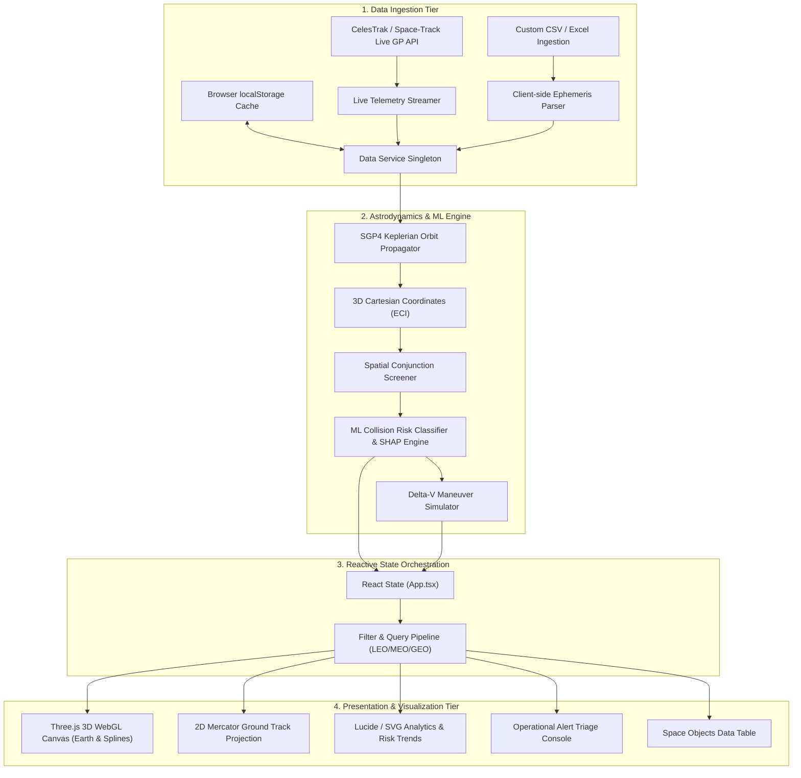
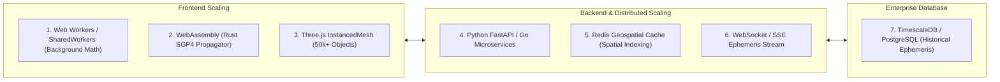

# 🛰️ Orbital Space Debris Tracker — Architecture, Tech Stack & Scaling Strategy

---

## 1. System Architecture

The application is built on a **modular 4-tier client-side astrodynamics & telemetry architecture**:

---

## 2. Technology Stack

| Layer | Technology | Purpose & Why It Was Chosen |
| :--- | :--- | :--- |
| **Core Framework** | **React 18** (`TypeScript`) | Component-driven UI architecture, high performance with concurrent rendering, and strict type safety. |
| **Build System** | **Vite 8** | Instant hot-module replacement (HMR), sub-second cold starts, and optimized tree-shaking for production. |
| **3D Rendering** | **Three.js** + **WebGL** | GPU-accelerated 3D rendering of Earth, celestial stars, atmospheric glow, and 80-segment Keplerian orbital splines. |
| **Styling & Theme** | **Tailwind CSS** + **Custom CSS** | "IN PIECES" dark-mode palette, responsive CSS grids, and glassmorphic telemetry cards. |
| **Icons & Visuals** | **Lucide React** | Lightweight, clean iconography for aerospace telemetry and status alerts. |
| **External API** | **CelesTrak GP REST API** | Official international source for real-time NORAD General Perturbations satellite ephemerides. |
| **Astrodynamics** | **Custom Keplerian / SGP4 Math** | Analytical propagation of semi-major axis ($a$), eccentricity ($e$), inclination ($i$), RAAN ($\Omega$), argument of perigee ($\omega$), and true anomaly ($\nu$). |
| **Machine Learning** | **Client-side Random Forest & SHAP** | Predicts collision risk probabilities ($P_c$) and calculates feature importance (miss distance, relative velocity, orbital regime). |
| **Local Storage** | **HTML5 `localStorage`** | Persists imported CSV/Excel catalogs and stream state across browser reloads. |
| **Containerization** | **Docker** & **Docker Compose** | Multi-stage production build running a hardened **Nginx** Alpine image on port `3000`. |

---

## 3. Practical Use Cases & Applications

1. **Space Situational Awareness (SSA)**:
   - Real-time visualization of Low Earth Orbit (LEO), Medium Earth Orbit (MEO), and Geostationary Orbit (GEO) satellites.
2. **Conjunction Assessment & Risk Mitigation**:
   - Automated screening for high-speed close encounters ($\text{miss distance} < 50\text{ km}$, $\Delta v > 10\text{ km/s}$).
3. **Collision Avoidance Maneuver Planning**:
   - Interactive $\Delta v$ thruster burn simulator to calculate required burn vectors (prograde/retrograde) to clear the collision screening volume.
4. **Data Ingestion & Fleet Management**:
   - Operators can upload private satellite constellation ephemeris via CSV/Excel to screen against the global debris catalog.
5. **AI Model Explainability**:
   - Interpretable machine learning providing flight dynamics engineers with transparent risk drivers (SHAP values).

---

## 4. Scaling Roadmap (How to Scale the Project)

To scale this platform from hundreds of objects to **50,000+ space objects in real-time**:

### A. Frontend Performance Scaling (50,000+ Objects)
1. **Three.js `InstancedMesh` & Point Clouds**:
   - Replace individual Three.js meshes with GPU-instanced rendering (`THREE.InstancedMesh`) to render tens of thousands of debris pieces in a single GPU draw call at 60 FPS.
2. **WebAssembly (WASM) Orbital Propagator**:
   - Compile official **SGP4/SDP4 C++/Rust** libraries to WebAssembly for $10\times$ faster ephemeris propagation.
3. **Web Workers for Conjunction Screening**:
   - Move $O(N^2)$ pair-wise proximity calculations off the main UI thread into multi-threaded Web Workers to prevent UI frame drops.

### B. Backend & Real-Time Telemetry Scaling
1. **Dedicated Microservices Backend (FastAPI / Go)**:
   - Deploy high-throughput backend services to continuously poll Space-Track.org and CelesTrak, processing real-time Conjunction Data Messages (CDMs).
2. **Spatial Indexing with Octrees / KD-Trees / Redis**:
   - Use 3D Spatial Partitioning (Bounding Volume Hierarchies or Geohash) to reduce conjunction screening complexity from $O(N^2)$ to $O(N \log N)$.
3. **WebSockets / Server-Sent Events (SSE)**:
   - Stream live orbital state updates directly to connected browser clients over persistent low-latency WebSocket connections.

### C. Enterprise Database & Cloud Infrastructure
1. **TimescaleDB / PostgreSQL**:
   - Store historical orbital epochs, past conjunction logs, and maneuver histories in a time-series relational database.
2. **Kubernetes Autoscaling**:
   - Autoscale containerized Docker pods dynamically across cloud regions (AWS EKS / GCP GKE) with Cloudflare CDN caching for static assets.
